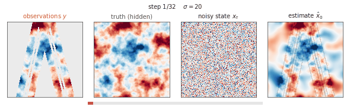
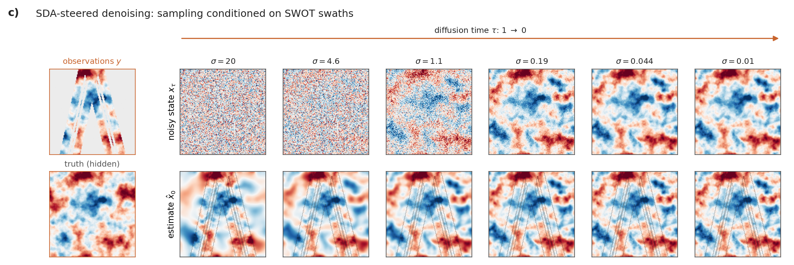

# ocean-sda-starter

> **Work in progress.** Code and documentation were adapted from research
> code with help from Claude and Codex and may contain errors or incomplete
> validation. Review and test them for your application; corrections are welcome.

**A reusable foundation for diffusion-based field reconstruction.**
This repository provides training, data-loading, and posterior-sampling
workflows that you can adapt to your own variables, datasets, and scientific
applications.

The included joint sea-surface height (SSH) and temperature (SST) model
serves primarily as a **worked demonstration** of those workflows. The
repository is intended to support efforts beyond that particular model,
including new oceanographic and other geophysical reconstruction problems.

I built it with help from Claude and Codex to make it easier to learn these
methods, run an example, and develop your own experiments from a common
starting point.

**Start here:** [Install](#install) · [Training and SDA inference](#training-and-sda-inference) ·
[Documentation](docs/README.md)

## Demonstration plots

These illustrative animations show fields emerging from Gaussian noise:
first without observations, then guided by two crossing SWOT passes.
They use synthetic fields with an SSH-like spectrum to demonstrate the
idea. For the training and assimilation diagrams, see
[the conceptual introduction](docs/introduction.md).

<p align="center">
  
  <br>
  <em>Figure 1. Generating a field without observations. The noisy state (top) and predicted clean field (bottom) evolve as noise decreases.</em>
</p>

<details><summary>Still frames: generation without observations</summary>

<p align="center">
  
</p>

</details>

<p align="center">
  
  <br>
  <em>Figure 2. Reconstructing a field from two crossing SWOT passes. Observations guide the model as noise decreases.</em>
</p>

<details><summary>Still frames: reconstruction from observations</summary>

<p align="center">
  
</p>

</details>

## Install

Requires Python ≥ 3.10 and PyTorch ≥ 2.1. Install in a fresh environment:

```bash
git clone https://github.com/tatsumonkman47/ocean-sda-starter.git && cd ocean-sda-starter
python -m venv .venv && source .venv/bin/activate
pip install -e '.[examples,dev]'
python -m pytest              # ~2 min on CPU
```

Import the package as `obottle_starter`. Keep the repository in place after
installation: the code locates `data/` relative to it.

The tests run on CPU; two checkpoint tests are skipped unless explicitly
enabled. See [installation details](docs/quickstart/installation.md) for the
tested environment and [checkpoint verification](docs/quickstart/downloads.md#verify-the-downloaded-models).

## Training and SDA inference

Use these workflows to train diffusion models or reconstruct fields from
observations with score-based data assimilation (SDA). Observations enter
at sampling time, so you can reuse a trained model with different measurement
patterns. The SSH/SST examples provide a starting point for your own experiments.

| Task | Start here | Requirements |
|---|---|---|
| Check the training pipeline | `python scripts/train.py config=configs/train_smoke_test.yaml` | About a minute on CPU; no download. Uses white noise, so loss need not decrease. |
| Train a small model | [Training guide](docs/quickstart/training.md), [notebook 02](examples/02_train_small.ipynb) | CPU or GPU; no download for synthetic fields |
| Download models and data | [Downloads](docs/quickstart/downloads.md) | Needed for the pretrained ocean examples |
| Reconstruct fields with SDA | [Inference guide](docs/quickstart/inference.md), [notebook 01](examples/01_prior_and_sda.ipynb) | Downloaded models and data; about 10 minutes on a GPU |
| Train on your own data | [Training data format](docs/quickstart/training.md#training-data-format), [units and scaling](docs/quickstart/units.md) | Your data and GPU |

### Optional methods and extensions

Different applications call for different ways of using observations. We
include conditional models and classifier-free guidance, as well as operators
for tracks, averages, and footprints with correlated observation errors.
These are optional additions to the training and SDA workflows.

| Method | Start here |
|---|---|
| Conditional models and classifier-free guidance | [Guide](docs/06_conditional_models.md), [notebook 04](examples/04_conditional_and_cfg.ipynb) |
| General observation operators | [Guide](docs/quickstart/units.md#other-observation-types), [notebook 03](examples/03_general_observations.ipynb) |
| Longer time series with sliding windows | [Guide](docs/08_windowed_sda.md), [notebook 05](examples/05_sliding_windows.ipynb) |
| Network or training changes | [Extensions](docs/05_extensions.md) |

## Documentation

Start with the [conceptual introduction](docs/introduction.md) for diagrams
of training and observation-guided sampling. The [documentation index](docs/README.md)
connects practical guides with deeper explanations of the network, training,
data preparation, and inference. It also includes a repository map.

For the work behind these methods, see the [literature guide](docs/07_literature.md).
[Planned additions](docs/roadmap.md) describes where I hope to take the project next.

## Project background

The network builds on NVIDIA cBottle and the diffusion formulation of
[Karras et al. (2022)](https://arxiv.org/abs/2206.00364). Reconstruction draws on
[Rozet and Louppe's SDA](https://arxiv.org/abs/2306.10574) and
[Rozet et al.'s MMPS](https://arxiv.org/abs/2405.13712), alongside geophysical
applications by [Martin et al.](https://doi.org/10.1029/2025MS005063) and
[Manshausen et al.](https://arxiv.org/abs/2406.16947).

[Our earlier study](https://doi.org/10.22541/essoar.15003398/v3) explains these
ideas for an oceanographic audience and evaluates separate SSH and SST models.
This repository extends that work with a joint SSH/SST model; that joint model
was not evaluated in the paper. See [research background and source projects](docs/background.md)
for fuller attribution and implementation provenance.

## Contributors

- **Tatsu Monkman** — research, model development, and repository direction.
- **Claude (Anthropic)** — AI coding contributor, assisting with code and documentation.
- **Codex (OpenAI)** — AI coding contributor, assisting with code and documentation.

Contributions are welcome, including bug reports, documentation corrections,
validation studies, and code improvements. Please open an issue or pull request.

## License

Apache-2.0 (`LICENSE.txt`), except the vendored azula subset
(`src/obottle_starter/inference/sda/_azula/`, MIT). See `THIRD_PARTY_LICENSES.md`.
