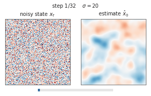
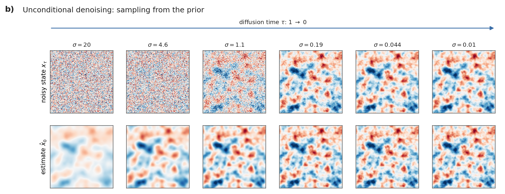

# 1. The network

The network has one immediate task: estimate a clean ocean field from a noisy
one. Training it to do this over many noise levels gives us a way to generate
new fields and, later, steer them toward observations. This page explains
that connection before looking inside the network.

## What a diffusion model learns

A diffusion model learns a distribution of ocean states `x`, each containing
several frames of SSH and SST on a 128 × 128 grid. It learns by denoising:
add Gaussian noise, `z_σ = x + σ ε` with `ε ~ N(0, I)`, and train a network
`D_θ(z_σ, σ)` to estimate the clean state. Once trained over a wide range
of noise levels, the model generates new states by starting from noise and
repeatedly denoising as `σ` decreases toward zero.

The noise level controls the signal-to-noise ratio. Features with
amplitudes below `σ` are difficult to recover. Since large spatial scales
usually contain more variance in ocean fields, they often emerge earlier
in sampling than fine-scale features. This relationship depends on the
data spectrum; diffusion noise level is not a spatial wavelength.

The animation shows the distinction between the **current noisy state**
(top) and the **estimated clean field** (bottom). As the noise level falls,
the two approach one another. These are steps in generation, not snapshots
of an ocean field evolving in physical time.

<p align="center">
  
  <br>
  <em>Sampling without observations. This illustration uses a Gaussian random field with an SSH-like spectrum and a closed-form denoiser, rather than the trained ocean network.</em>
</p>

<details>
<summary>View still frames</summary>

<p align="center">
  
  <br>
  <em>Selected steps from the animation, arranged from high to low noise.</em>
</p>

</details>

### From a denoiser to a probability distribution

A single denoised estimate is a conditional mean, not a new random sample.
Sampling requires a sequence of denoising steps, beginning from a random
state. Three results explain why the same network can support both
sampling and data assimilation:

1. The training loss is a squared error, so the best possible denoiser (the
   population optimum, with unlimited data and capacity) is the
   **expected clean state given the noisy one**,
   `D(z_σ, σ) = E[x | z_σ]`. A trained network approximates it.
2. **Tweedie's identity** links that conditional mean to the gradient of
   the log-density of noisy states (the "score"):
   `∇ log p(z_σ) = (E[x | z_σ] − z_σ) / σ²`. The score points toward increasing probability density at the current
   noise level. Replacing the conditional mean by `D_θ` gives the score
   approximation used in sampling.
3. For the exact conditional mean, its Jacobian gives the uncertainty of
   that estimate: `Cov[x | z_σ] = σ² ∂E[x | z_σ]/∂z_σ`. With a learned
   denoiser this is an approximation (the learned Jacobian need not even be
   symmetric). MMPS uses this relation to estimate how much uncertainty
   remains after denoising.

## Scaling the network inputs and outputs (EDM preconditioning)

The input magnitude varies greatly between `σ = 200` and `σ = 0.0002`.
EDM preconditioning (Karras et al., 2022) uses fixed scaling factors around
the U-Net `F_θ` to keep its inputs and training targets near unit magnitude:

```
D_θ(z, σ, c) = c_skip(σ) · z  +  c_out(σ) · F_θ( [c_in(σ) · z, c_maps],  c_noise(σ),  c_rest )

c_in   = 1 / sqrt(σ² + σ_data²)
c_skip = σ_data² / (σ² + σ_data²)
c_out  = σ · σ_data / sqrt(σ² + σ_data²)
c_noise = ln(σ) / 4
```

**How to read the formula.** `c_in` scales the noisy input, `c_skip`
retains part of it, and `c_out` scales the network correction. `c_noise`
encodes the noise level supplied to the network.

Only the noisy state is scaled by `c_in`. The context maps (`c_maps`: the
frame-offset encodings and, for a conditional model, observation maps) are
concatenated to it unscaled, and the rest of the context (`c_rest`: frame
offsets, calendar, labels) enters through embeddings, as `c_noise` does.

`σ_data` is the typical standard deviation of the (normalized) data, 1.0
for the released models. At small σ, `c_skip ≈ 1`: the input is nearly
clean, so `D` mostly passes it through and `F` predicts a small correction.
At large σ, `c_skip ≈ 0`: the scaled output of `F` supplies the clean-field
estimate. The implementation is `EDMPrecond` in
`src/obottle_starter/core/nn/networks.py`.

## The U-Net (`SongUNet`)

The U-Net processes the field at several resolutions. Coarse levels can
represent broad structures, while fine levels retain local detail. The
encoder reduces the grid size; the decoder brings it back to the original
resolution. Together they give the network its U shape:

```
128x128 ─ blocks ────────────────────────────── blocks ─ 128x128   (96 channels)
   │ downsample                                     ▲ upsample
 64x64 ─ blocks ──────────────────────── blocks ─ 64x64            (192)
   │                                                ▲
 32x32 ─ blocks + temporal attn ── blocks + temporal attn ─ 32x32  (192)
   │                                                ▲
 16x16 ─ blocks + spatial attn + temporal attn ─────┘              (192)
```

- The **encoder** (left) halves the grid at each level and adds feature
  channels, so deep layers see large areas with many features. The
  **decoder** (right) builds the grid back up.
- **Skip connections** (horizontal lines) pass encoder features directly to
  the decoder at the same size, preserving fine detail that may be lost
  at the coarsest resolution.
- Each level has `num_blocks` **residual blocks**. These learn a correction
  to their input using convolutions, group normalization (GroupNorm), and
  a nonlinear activation (SiLU). Adding the input back lets a block retain
  features as well as modify them.
- **Spatial self-attention** at 16 × 16 (`attn_resolutions`) couples every
  grid point to every other point. A single 3 × 3 convolution couples
  only neighbouring points.

In the config these are `model_channels` (96), `channel_mult` ([1, 2, 2, 2]),
`num_blocks` (2) and `attn_resolutions` ([16]). Patches must be square and
divisible by 2 once per downsampling; `attn_resolutions` and
`temporal_attn_resolutions` are grid sizes, so they must name levels that
exist. Both are checked before the network is built, and training prints
the resulting levels, widths and attention placement. With these the released
models have 23.7 million parameters. "SongUNet" refers to Song et al.
(2021)'s DDPM++ architecture, as configured in EDM.

## Spatial and temporal coupling

Each sample contains `time_length` frames (5 or 11 in the released models).
The network processes them together in an array of shape
`(batch, channels, frames, pixels)`.

- **Convolutions and spatial attention act on each frame separately**
  (`mixing_type: spatial`). On their own they could not relate one frame to
  another.
- **Temporal attention** (at 32 × 32 and 16 × 16, `temporal_attn_resolutions`,
  plus the bottom and upsampling blocks of the decoder) couples features at
  each grid point across frames. Combined with spatial layers, this allows the
  model to represent evolving structures such as moving eddies. The pattern,
  spatial layers plus temporal attention, follows Ho et al. (2022).

### Representing frame times

A sequence of five frames does not by itself specify how much time has
passed. An eddy moving between hourly frames represents a different rate
of evolution from the same displacement over ten days. We therefore pass
frame timestamps to the model as additional inputs.

Frame intervals may range from hours to days. The released models
represent this timing through four mechanisms, configured by
`src/obottle_starter/core/conditioning.py`:

| Mechanism | Config key | What it gives the network |
|---|---|---|
| Offset channels | `temporal_offset_channels: 32` | 32 sine/cosine encodings of each frame's offset from frame 0 (hours), as extra input maps. Periods from 7.2 h to 7,200 h. |
| Attention time bias | always on | Temporal attention adds a learned function of the time difference between each pair of frames (periods 1–1,000 h) to its attention scores. |
| Per-frame AdaGN | `use_per_frame_adagn: true` | Each frame's offset is embedded and added to the noise-level embedding, so every residual block gets a frame-specific signal. See below and page 5. |
| Calendar | `calendar_embed_channels: 8` | Day of year (seasons) and local solar time of day (diurnal cycle), as extra input maps. |

The time of day is local to the patch: UTC time plus longitude × 4 minutes
per degree. This is why `assimilate` needs `center_lon`.

These mechanisms serve different purposes, but their individual
contributions have not been isolated in controlled comparisons. To test
one, train otherwise identical models with it enabled and disabled, then
compare SDA errors across frame spacings and temporal correlations in
prior samples. Training loss alone is insufficient.

### Frame-dependent adjustments within the network (AdaGN)

Each residual block receives a vector representing the noise level. With
`use_per_frame_adagn`, a learned representation of each frame's time offset
is added to that vector. The block converts the result into an additive
adjustment for each feature channel, applied **before the second group
normalization (GroupNorm)**.

The configuration calls this AdaGN (adaptive group normalization), but the
released models use EDM's additive variant, with `adaptive_scale` disabled.
AdaGN more commonly means applying both a scale and a shift *after*
normalization. That variant is available through
`per_frame_adaptive_scale: true`; it changes parameter shapes and therefore
requires a new model. See page 5.

The projection from frame-time embeddings is initialized to zero, so this
adjustment initially has no effect. Page 5 describes comparisons that
could establish its contribution.

## Unused inputs in the released models

- `label_dim: 8`. There is a slot for a global label vector, but the code
  always passes zeros, so it acts as a learned constant. It is kept because
  the released checkpoints contain its weights.
- No observation maps are fed to the released networks. They are
  unconditional; observations enter only at inference, through SDA. The
  `conditioning` section can add observation inputs for new models; see
  [page 6](06_conditional_models.md).

## Code reference

| What | Where |
|---|---|
| Build the network from a config | `src/obottle_starter/core/model.py`, `build_model` |
| U-Net, blocks, attention, preconditioning | `src/obottle_starter/core/nn/networks.py` (`SongUNet`, `UNetBlock`, `TemporalAttention`, `EDMPrecond`) |
| Time and calendar embeddings | `src/obottle_starter/core/nn/embedding.py`, `src/obottle_starter/core/conditioning.py` |
