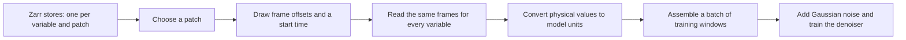

# 3. Preparing and sampling training data

The training distribution is determined by what the data loader selects:
locations, variables, frame times, and preprocessing. These choices matter
as much as the network architecture. If your application uses different
fields or sampling intervals, this is the place to adapt the workflow.

The model learns from sequences of local fields extracted from **llc4320**:
an MITgcm global ocean run at 1/48° (about 1–2 km grid spacing) with
hourly output for roughly a year (September 2011 to September 2012, 9,030
hourly frames in the stores used here). There are two ways to turn that
into training samples. This repository uses the first; newer work in the
parent project uses the second.

## Precomputed regional patches (used here)

Regrid the simulation once onto regularly spaced local grids, then save
each location as a separate dataset. Training reads these precomputed
patches, called tiles.

- **Grid.** Each tile is 128 × 128 cells at 4 km on a local azimuthal
  equidistant (AEQD) projection centred on the tile, which preserves
  distances from the centre. A tile spans
  512 km. This is coarser than llc4320's native grid (about 2 km).
- **Files.** One zarr store per variable and tile,
  `{data_dir}/{field}/{patch_id}.zarr`, each holding every hourly frame for
  that tile (`time, row, col`; rows south to north). The released models
  used 415 North Pacific tiles avoiding land.
- **Fields.** SSH with scales longer than 300 km removed (a spatial
  high-pass, so the basin-scale gradient and the seasonal steric signal do
  not dominate), and SST.
- **Sampling.** `PatchDataset` (`src/obottle_starter/training/data.py`)
  picks a random tile, draws frame offsets (below), picks a random start
  time, and reads just those frames.

### From stored fields to a training batch

*One window contains several variables and frame times on the same grid.
The spatial and temporal selections must agree across variables; the added
training noise is generated after selecting the clean fields.*

**Why use precomputed tiles?** They are simple, fast to read, and easy to share (the bundled
`training_patches/` is a few tiles of this kind), and the flat 4 km grid
matches how satellite observations are usually gridded.

**Limitations:** the model only ever sees the chosen tile centres, so
spatial variety is limited to 415 locations. Projection and resampling
smooth the field slightly and fix the resolution at 4 km. Each additional
variable must be regridded to the same tiles.

## Sampling the original simulation grid (not included here)

This alternative is useful context if you are planning a larger training
dataset. You do not need it to run or extend the tile-based examples.

The parent project also samples patches directly from a regional Zarr
store on the original llc4320 grid, choosing a random location for each
sample.

- **Grid.** 128 × 128 native llc4320 cells (about 1.5–2 km each near
  mid-latitudes, so about 200–280 km across). No resampling: the patch retains
  the simulation values. Grid spacing varies slightly with latitude, which the
  model has to tolerate.
- **Store.** A single stitched zarr store per region, e.g. the North Atlantic
  (2,285 × 3,360 cells, 9,030 hourly frames), with masks identifying ocean
  cells and excluding cells within 400 km of land.
- **Sampling.** Any valid centre can be chosen, providing more distinct
  training locations. A patch must lie entirely in valid ocean.
- **Performance.** Zarr stores data in chunks (blocks of space and time).
  Reading one 128 × 128 patch can mean decompressing several 512 × 512 chunks,
  although only a fraction of their values are needed. The parent project's
  loader therefore reads a **group** of nearby, non-overlapping patches that
  share one time window and one set of chunks (four patches by default), and
  mixes groups from different places and times into each batch. In the parent
  project's benchmarks grouping gave a large throughput gain (historical; not
  reproduced in this repository).

**Strengths:** far more spatial variety, no regridding artefacts,
straightforward to add fields that live on the same grid, and new regions
need no preprocessing.

**Limitations:** performance depends strongly on storage layout and read
speed. Patches in a group are correlated (same time, nearby places), so groups must be mixed.
The stores are large (the Atlantic one is about 870 GB), so they are hard
to share, and the grid is not exactly uniform.

This repository does not include the native-grid loader: it is about 1,300
lines tied to that store's layout. `PatchDataset` reads any data in the
tile layout, so the simplest way to train on another product is to export
tiles from it, then list its variables (directory, units, normalization) in
the config.

## Data requirements and validation

`PatchDataset` raises an error identifying the affected store or frames if:

- A window contains NaN or infinite values; the loss requires complete
  targets (page 2).
- A store contains several data variables and `source_variable` does not
  select one.
- Stores for different variables have different timestamps.

The loader assumes hourly data, so a time index is also the number of hours
since the first frame. Irregular source times would require selection by
timestamp, which is not implemented.

## Generated fields for experiments and testing

If you want to learn the workflow before preparing ocean data, use
`data_source: structured` (`StructuredDataset`,
`configs/train_structured.yaml`). It generates Gaussian random fields with
three controllable properties:

- **Spatial spectrum:** `structured.spectral_slope` sets the power-law slope.
- **Evolution:** the fields drift together in a random direction at
  `structured.speed_cells_per_day`.
- **Relations between variables:** each additional variable has correlation
  `structured.correlation` with the first, at every spatial scale.

This gives you known statistics to compare with generated samples. It also
provides an SDA test: observing one variable should help reconstruct another
when their correlation is nonzero.

These fields are a controlled example, not an ocean simulation. They are
Gaussian and periodic, while the network uses zero padding at its edges.
The separate `data_source: synthetic` option generates white noise and is
intended only to check that the code runs.

## Choosing frame times

Each sample needs `time_length` frame times. How they are chosen decides
what the model learns about time evolution.

- `uniform_stride`: frames equally spaced, stride drawn from
  `llc_dtime_choices` (hours). Simple, but the model only learns the
  strides you list.
- `nonuniform_offsets` (the default): draw a total span uniformly between
  `nonuniform_minimum_offset_hours × (T−1)` and `nonuniform_max_span_hours`
  (4–336 h for 5 frames), then scatter the other frames randomly inside it
  on a 1-hour grid. This trains the model on irregular
  frame spacing within the chosen range.

**Actual frame spacing.** The drawn span is an upper limit: the last frame lands anywhere inside it. For the default 5-frame
setting, a simulation of this sampler gives a median first-to-last span of
131 h, and 64% of samples span a week or less. The median gap between
adjacent frames is 21 h: 23% of gaps are 6 h or less and 54% are 24 h or
less.

**Match training to your application.** If you mostly assimilate frames at one spacing (the OSSE tiles are
12-hourly), make sure training covers it well, for example by shortening
`nonuniform_max_span_hours` or switching to `uniform_stride`. The parent
project's newer loader mixes regular and irregular spacing for this reason.

`nonuniform_max_span_hours` is therefore the *nominal maximum* span. The
actual first-to-last span of a sample is at most that, and usually less.

## Matching units and grids during reconstruction

The normalization a model was trained with is saved in the checkpoint and
reused automatically ([Units and scaling](quickstart/units.md)).

Grid spacing must also match: the released models were trained on 4 km AEQD tiles, and
the OSSE tiles are on the same kind of grid. If you assimilate data on a
different grid (say native llc4320 cells or a 0.05° map), resample it to
4 km first, or the model will see features at the wrong size.

## Code reference

| What | Where |
|---|---|
| Tile dataset and frame-time sampling | `src/obottle_starter/training/data.py` (`PatchDataset`, `draw_offsets`) |
| Generated structured data | `src/obottle_starter/training/data.py` (`StructuredDataset`, `structured_fields`) |
| Making a small tile subset to share | `scripts/maintainer/make_training_subset.py` |
| OSSE tiles for inference | `src/obottle_starter/inference/osse.py` |
