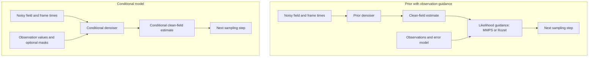

# 6. Conditional models (experimental)

> **Status:** basic checks cover model construction, training, loading, and
> sampling. No conditional model has yet been trained on real data or
> evaluated for reconstruction quality in this repository.

## Two ways to use observations

So far, we have trained a model on complete fields and supplied observations
only when reconstructing a field. Here we make a different choice: supply
observations during training too, so the network learns how to use them.

The released models are **unconditional priors**: they learn a distribution of ocean
states without observation inputs. Data assimilation (page 4) introduces
observations during sampling. A **conditional model** instead
takes the observations as extra input channels and learns to approximate
`p(state | observations)` directly.

| | Unconditional prior + SDA | Conditional model |
|---|---|---|
| Observations enter | at inference, through guidance | as network inputs, in training and inference |
| New mask, `σ_y` or observed variable | works with no retraining | only reliable if training included similar ones |
| Cost per sampling step | MMPS: several network passes; Rozet: about two | one pass (M_3), two (M_4) |
| Training data | states only | states plus simulated observations of them |
| Main risk | guidance not propagating information well | training observations unlike the real ones |

### Where observations enter



*In SDA, observations modify the denoiser's prediction through a likelihood
update. In conditional sampling, observations are inputs to the network
itself, during both training and reconstruction. CFG, described below,
combines predictions with and without those observation inputs.*

Suresh Babu, Sadam & Lermusiaux (2026) compared four approaches on
quasi-geostrophic turbulence. They called the conditional model **M_3** and
the conditional model with classifier-free guidance **M_4**. These had the
lowest errors in their tests; guidance with Diffusion Posterior Sampling
(M_2) smoothed fine scales. They did not test MMPS, this repository's
default. See [the literature page](07_literature.md).

## Representing observations as network inputs

For each variable in `conditioning.observe`, the network receives:

1. **Values:** the observed value in model units at observed cells, 0
   elsewhere.
2. **Mask** (if `mask_channel: true`): 1 at observed cells, 0 elsewhere.

All the value channels come first, then all the mask channels, then the
usual frame-time encodings. Observations are per frame, so a swath that
moves between frames is represented naturally.

**Why include a mask?** Suppose an unobserved cell is filled with zero.
Without a separate mask, the network cannot tell that cell from a real
observation whose normalized value is zero. A mask makes that distinction
explicit.
Suresh Babu et al. used no mask; it is optional here so you can compare.

**No-observation input (the null condition).** Setting all values and masks to
zero indicates that no observations are available. A conditional model trained
with some null conditions also works as an unconditional prior.

## Training a conditional model

Configure observation inputs in `conditioning` in `configs/train_base.yaml`;
`configs/train_conditional.yaml` is a ready-made example.

```yaml
conditioning:
  mode: observations          # none = unconditional (default)
  observe: [SSH, SST]         # which variables are observed; any subset
  mask_channel: true
  training_observations:      # synthetic observations, fresh for every sample;
                              # each value is a number or a map per variable
    masks: stripes            # bernoulli (random cells) | stripes (random bands)
    coverage: {SSH: 0.1, SST: 0.3}
    stripe_width: {SSH: 30, SST: 60}
    stripes_per_frame: {SSH: 1, SST: 2}
    frame_probability: 1.0    # chance a variable is observed in a frame at all
    noise_std: {SSH: 0.005, SST: 0.1}   # physical units
    null_probability: 0.1     # > 0 trains the null branch CFG (M_4) needs
```

`null_probability` controls how often all observation inputs are removed
during training. It is independent of `label_dropout`, which applies to
the unused global label vector retained for checkpoint compatibility.
Only `null_probability` trains the no-observation prediction used by CFG;
`guidance="cfg"` rejects a model trained with `null_probability: 0`.

During training, each sample's target is observed through freshly drawn
masks with Gaussian noise (`training/obs_simulation.py`), and the model
learns to denoise given those observations. With `null_probability: 0.1`,
one sample in ten sees the null condition instead.

**Start from a released prior.** `init_from=checkpoints/joint_ssh_sst_T5.pt`
copies its weights and adds the new input channels with zero weights, so
training begins from a model that ignores the observations and reproduces the
prior exactly. The variables, their order and normalization, and the network
must match the source's; the log lists the copied and expanded parameters.
Initializing this way may reduce the training required compared with random
initialization:

```bash
python scripts/train.py config=configs/train_conditional.yaml \
    data_dir=/path/to/patches init_from=checkpoints/joint_ssh_sst_T5.pt
```

### Choosing the training observations

Think of the simulated observations as part of the training data, just as
much as the clean ocean fields. A model trained on isolated points has not
automatically learned how to use a wide swath or a large cloud gap.

- `bernoulli` scatters isolated observed cells. This is simple but does not represent
  typical instrument coverage.
- `stripes` draws straight bands at random angles, an approximation to
  swaths (SWOT, nadir tracks) and large cloud gaps in SST.
- To use real coverage (SWOT and nadir footprints, cloud masks), replace
  `simulate_masks` in `training/obs_simulation.py` with a sampler that
  draws masks from a library of real footprints. The OSSE tiles hold a few
  examples; a representative training library would require more.
- Vary coverage and noise during training if you want a model that copes
  with a range of conditions. Values and masks alone do not tell the
  network how noisy an observation is: a model trained on a mixture of
  noise levels must account for that mixture without an explicit noise
  parameter at inference. An additional input could specify the noise
  level explicitly; this is not implemented. Likewise, a coarse product interpolated to
  the fine grid is not a set of independent fine-grid observations.
- Validate on observing systems the model was trained on and on different
  observation patterns and coverage.

## Sampling

In `configs/sda.yaml`, `guidance.method` chooses how the observations are
used:

| `guidance.method` | What happens | Model |
|---|---|---|
| `conditional` | Observations enter only as inputs; plain sampling (M_3) | conditional |
| `cfg` | Classifier-free guidance with weight `classifier_free.weight` (M_4) | conditional, trained with `null_probability > 0` |
| `mmps`, `rozet` | Unconditional prior: guidance only. Conditional model: observations enter as inputs **and** through guidance (hybrid, unvalidated) | any |

### What the classifier-free guidance weight does

Classifier-free guidance (CFG; Ho & Salimans, 2022) compares two predictions
from the same model: one with observations and one with those inputs set to
zero. No separate classifier is needed. The combination is
`x̂ = x̂_uncond + w (x̂_cond − x̂_uncond)`.

- **`w = 0`:** use the prediction without observations.
- **`w = 1`:** use the ordinary conditional prediction.
- **`w > 1`:** extrapolate further in the direction associated with the
  observations. This can strengthen conditioning but reduce ensemble spread.

The weight is not an observation-error standard deviation. Check both
reconstruction error and spread when choosing it.

In Python:

```python
post = obs.assimilate(net, cfg, times=..., center_lon=..., truth=..., masks=...,
                      sigma_y={"SSH": 0.005, "SST": 0.1},
                      guidance="cfg", cfg_weight=1.5)
```

The model only takes observations of the channels in its
`conditioning.observe` list. Others are ignored by `conditional` and `cfg`
(with a warning) but still used by `mmps` and `rozet`.

### Combining conditioning with likelihood guidance

Combining a conditional model with MMPS or Rozet guidance is implemented
but unvalidated. If the model already approximates `p(x | y)`, applying
the likelihood of the same `y` again counts the evidence twice and may
produce an ensemble with too little spread. The effect requires analysis
and experiments.

Using one source as a network input and a different source for guidance
can be appropriate when the sources are conditionally independent given
the state. `assimilate` reports combined use of conditioning and guidance
and records the method in the output's `route` attribute.

## Worked example: notebook 04

`examples/04_conditional_and_cfg.ipynb` trains and evaluates a small model
on generated fields; no model or data download is required. It uses noisy
bands of observations from one variable and `null_probability: 0.2`
(`configs/train_structured_conditional.yaml`).

The notebook compares conditional sampling with CFG weights from 0
(no-observation prediction) to 4. It plots ensemble-mean error and spread
inside and outside the observed bands, for both variables.

## Configuration changes and code extensions

**Configuration is enough** to choose observed variables (`observe`),
mask patterns, coverage, training noise, and `null_probability`. You can also
enable a mask channel, initialize from a prior (`init_from`), and choose the
sampling method and CFG weight. These options all use observations of model
variables, represented as values and masks on the model grid.

Additional types of input require code changes. Two examples:

| Experiment | Files to change |
|---|---|
| Give the model the observation-noise level, so sampling can use an explicit `sigma_y` across several noise levels | `training/obs_simulation.py` (`training_condition`: draw the noise level per sample, build its channel); `core/obs_conditioning.py` (`observation_channels`, `build_obs_condition`: one more channel); `inference/assimilate.py` (build the same channel from `sigma_y`) |
| Other context: wind, a coarse product, a forcing field | `training/data.py` (the dataset returns it); `core/obs_conditioning.py` or a sibling module (turn it into input channels); `training/train.py` and `inference/assimilate.py` (pass it in, as the observation condition is) |

In both cases the input layer grows, so start a new run (or use
`init_from`, which pads new input channels with zeros), and add a test
like those in `tests/test_conditional.py`.

## Suggested experiments

- Train M_3 and M_4 with `stripes`, compare them with MMPS on the OSSE
  tiles, then evaluate them on observation patterns excluded from training.
- `mask_channel: true` against `false`.
- Observing only SSH (`observe: [SSH]`) in a joint SSH + SST model, to
  learn SST reconstruction from SSH.
- A library of real SWOT, nadir and cloud footprints for training masks.

## Code reference

| What | Where |
|---|---|
| Building the observation inputs | `src/obottle_starter/core/obs_conditioning.py` |
| Synthetic training observations | `src/obottle_starter/training/obs_simulation.py` |
| Starting from an unconditional checkpoint | `src/obottle_starter/core/model.py`, `load_weights_padded` |
| Classifier-free guidance | `src/obottle_starter/inference/sda/cfg.py` |
| Sampling with a conditional model | `src/obottle_starter/inference/assimilate.py` |
