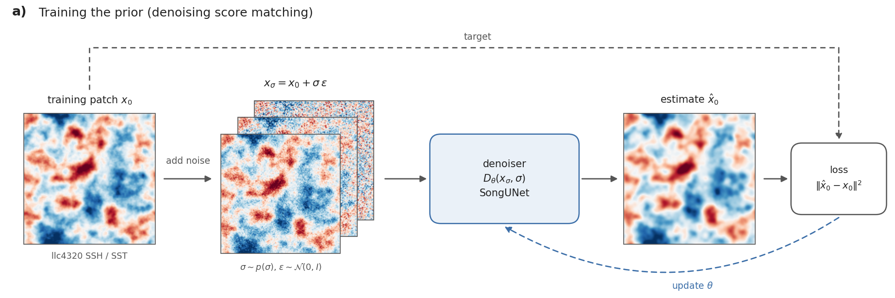
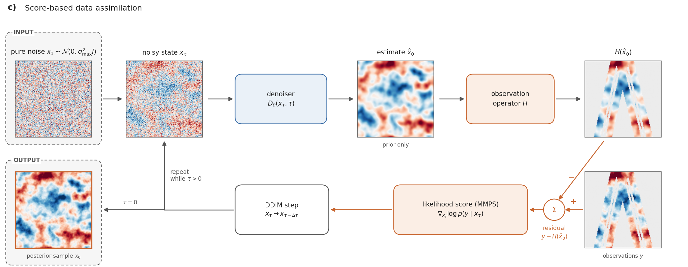
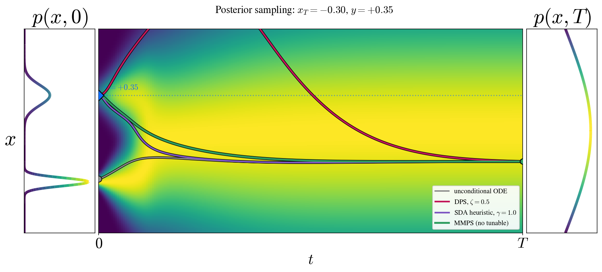
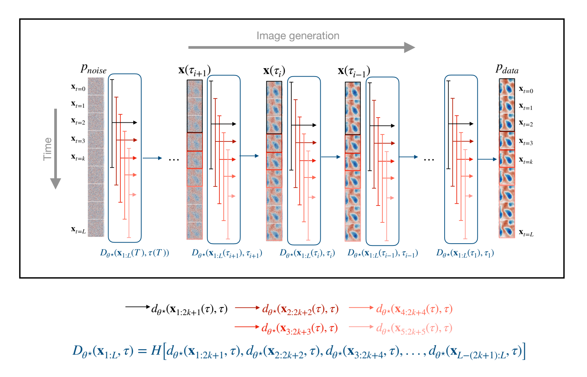

# Intro to diffusion models and score-based data assimilation

**Score-based data assimilation (SDA)** steers a pretrained diffusion model
using observations at sampling time. Here, we reconstruct joint SSH/SST
fields from synthetic observations derived from the MITgcm llc4320 simulation.

Diffusion posterior sampling methods adjust each sampling step using the
**likelihood score**: a direction that makes the current state more consistent
with the observations, accounting for their noise. We use noisy observations
as soft constraints because measurements are uncertain. This combines the
model's learned distribution with the observation likelihood through Bayes'
rule, and uses automatic differentiation through the network to compute the
update. See [Chung et al. (2023)](https://arxiv.org/abs/2209.14687),
[Rozet and Louppe (2023)](https://arxiv.org/abs/2306.10574), and
[Rozet et al. (2024)](https://arxiv.org/abs/2405.13712).

For a detailed introduction aimed at fellow newcomers, see
[my preprint](https://doi.org/10.22541/essoar.15003398/v3). That study evaluates
**two independent models: one for SSH and one for SST**. This repository
builds on that work with several upgrades, including a joint SSH/SST model.

The [demonstration plots in the README](../README.md#diffusion-models-and-posterior-sampling-for-ocean-state-reconstruction) illustrate generation
with and without observations. The diagrams below explain how the model
is trained and how observations guide sampling.

## Training: learn to remove noise

Add Gaussian noise at a random level $\sigma$ to a clean
patch $x_0$. Train the denoiser $D_\theta$ to recover the original patch.
Repeating this across noise levels teaches the model the distribution of
ocean fields. See [Training](02_training.md).

  
   
  <em>Figure 1. Training the network to recover a clean field from a noisy input.</em>

## Sampling: generate a field

Start from Gaussian noise and repeatedly denoise while lowering
$\sigma$. At each step, the model predicts a clean field $\hat{x}_0$,
and the sampler updates the noisy state $x_\tau$. In the
[first demonstration](../README.md#diffusion-models-and-posterior-sampling-for-ocean-state-reconstruction), these appear in the bottom
and top panels, respectively.

## Data assimilation: incorporate observations

SDA combines a trained model (the "prior") with
observations to generate reconstructions. Each step compares the model's
prediction with the observations and uses the difference to guide the next
update.

**Accounting for uncertainty.** MMPS estimates uncertainty in the denoised
prediction from the network's derivatives. This makes the observation update
more expensive than using a prescribed variance, but allows it to depend on
the model's prediction. The alternative `rozet` guidance uses
[Rozet and Louppe (2023)](https://arxiv.org/abs/2306.10574)'s variance heuristic.

**Reconstructing gaps and uncertainty.** The resulting samples reconstruct unobserved regions by sampling from the model's learned prior.
Different initial noise produces a set of possible
reconstructions (an ensemble). Because observations enter at sampling time, the same model can support different
observation patterns, instruments, and error levels. See
[Inference and SDA](04_inference_sda.md) for the equations and methods,
and [the literature guide](07_literature.md#applications-to-geophysical-data-assimilation)
for ocean applications.

  
   
  <em>Figure 2. The reconstruction cycle: denoise, compare with observations, update, and repeat.</em>

## Comparing posterior-sampling methods

DPS neglects uncertainty in the denoised estimate; Rozet and Louppe's
heuristic prescribes it; **MMPS estimates it from the denoiser**. These choices
can produce different sampling trajectories, even with the same initial
noise and observation. See [the method comparison](04_inference_sda.md#three-ways-to-handle-the-uncertainty)
for the equations and limitations.

Figure 3 — DPS, SDA guidance, and MMPS in a one-dimensional example

  
   
  <em>Figure 3. Read from right to left, from the noisy state to the reconstruction. The curves illustrate one observation and one choice of settings, not a general ranking of the methods. The SDA curve uses gamma = 1; this repository defaults to 0.1.</em>

## Longer time series with sliding windows

**A model trained on short sequences can reconstruct a longer period.**
Following [Rozet and Louppe (2023)](https://arxiv.org/abs/2306.10574), we run
one diffusion process over the full sequence. At each step, overlapping
short windows are denoised and their central predictions assembled into a
full-sequence estimate, with special handling at the endpoints.

This reuses the trained model without averaging independently generated
sequences. The current implementation supports unconditional priors;
accuracy depends on how well local windows represent the longer sequence.
See [Sliding windows](08_windowed_sda.md) for commands, memory costs,
and validation checks. This extends the reconstruction in **time**;
spatial tiling is a separate method.

Figure 4 — How overlapping temporal windows form a long-sequence prediction

  
   
  <em>Figure 4. Physical time runs vertically; denoising progresses horizontally. Overlapping windows provide local predictions at each step of the full-sequence sampling process. Click the figure for the original PDF.</em>

## Model and sampling method

- **Network:** NVIDIA cBottle's EDM-preconditioned `SongUNet`, with temporal
  attention added for irregularly spaced ocean time series.
- **Reconstruction:** Moment Matching Posterior Sampling
  (MMPS; [Rozet et al., 2024](https://arxiv.org/abs/2405.13712)), with a DDIM
  sampler and a vendored subset of [azula](https://github.com/probabilists/azula).

---

[Documentation index](README.md) · [Project README](../README.md)
